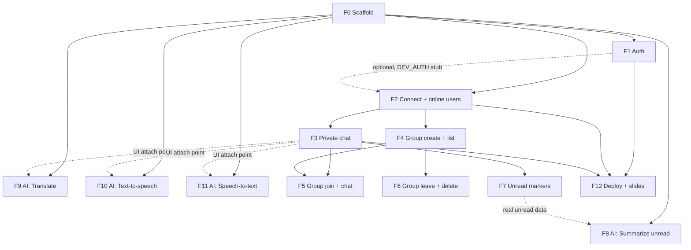

# Plan: four people in parallel

Stack: FastAPI + Motor + `google-genai` (backend), Vite + React + TypeScript + Tailwind (frontend), MongoDB Atlas M0, Render free. See `docs/adr/` and `GLOSSARY.md`.

## Step 0 — scaffold (one person, ~1 hour, everyone waits)
Create the skeleton so nobody touches the same file later:
```
backend/app/main.py        # mounts routers, serves frontend/dist
backend/app/db.py          # get_db() (Motor)
backend/app/deps.py        # get_current_user() -> username   [STUB: returns "test"; P2 replaces]
backend/app/auth/          # P2
backend/app/chat/          # P1  (ws.py, hub.py, repo.py, rooms.py)
backend/app/ai/            # P4
backend/tests/
frontend/src/{api,ws,components,pages,ai}/   # see owners below
.env.example               # MONGODB_URI, JWT_SECRET, GEMINI_API_KEY
```
Everything after this follows `docs/CONTRACT.md`. Each person works in their own folders; shared files (`main.py`, `deps.py`) are touched only at the stated hand-offs.

## Workstreams

### P1 — Chat core (backend)  · `backend/app/chat/`
WebSocket endpoint, connection hub, presence, Private Rooms, Groups (create/join/leave/delete), history, read markers, unread counts. Mongo `rooms`, `messages`, `read_markers`.
- Covers R4–R11, AI-free.
- Tests (`pytest`): non-member gets no group messages, creator cannot leave, only creator deletes, joiner sees full history, own messages never unread, private room only reaches its two users.
- Needs from others: `deps.get_current_user` — uses the stub; works standalone.

### P2 — Auth, users, infra  · `backend/app/auth/`, `Dockerfile`, deploy, slides
Register/login (bcrypt, JWT), `/api/me`, token check for the WS, `users` collection, broadcast of new users as `presence` via a hub function `announce_new_user(username)` (P1 provides it; P2 calls it after register — leave a TODO until P1 lands). Then: Dockerfile, Render + Atlas setup, LAN fallback instructions, and the Implementation Explanation slides (protocol stack, why WebSocket, R1/R2 answers).
- Covers R3 and the cloud bonus.
- Hand-off: replace the `deps.py` stub with real JWT validation, and expose `verify_token(token) -> username | None` for P1's WS (until then P1 uses the stub).

### P3 — Frontend chat app  · `frontend/src/{ws,components,pages}`, `api/auth.ts`
Login/register pages, one WebSocket client hook with reconnect, state store, sidebar (users with online dots, group list with member lists, join/leave/delete buttons), chat room view (message window + chat box), unread badges and read-marking on visible rooms.
- Covers the UI half of R3–R11.
- Develops against a small mock WebSocket server (`frontend/mock-server.ts`) that speaks the contract, so it needs neither P1 nor P2.
- Exposes slots for P4 (see below): `<MessageItem>` renders `<MessageActions message={m} />`, and the room header and chat box render `<RoomAiBar />` and `<MicButton />` — P3 creates these as empty placeholders.

### P4 — AI vertical slice  · `backend/app/ai/`, `frontend/src/ai/`
Backend: `/api/ai/{summarize,translate,stt,tts}` using Gemini with one key; input validation (caps, MIME, size); friendly error when quota is hit. Frontend: replaces P3's placeholders, in `frontend/src/ai/`, with `RoomAiBar` (Summarize unread, shown when unread > 0, sends the latest ≤200 unread messages), `MessageActions` (Translate, Speak), `MicButton` (record → STT → fills chat box), and a target-language select that calls `PUT /api/me`.
- Covers all four Part 3 points.
- Develops against stubs: call the endpoints directly with curl/pytest, and test the components in isolation (Vite playground page with fake messages). Needs no live chat.
- Check on day 1: that the Gemini TTS model is free on your key; otherwise fall back to `speechSynthesis` for TTS only.

## Hand-off points (the only dependencies)
| # | From → To | What | Fallback until then |
|---|---|---|---|
| 1 | P2 → P1, P4 | real `get_current_user` / `verify_token` | stub returns a fixed user |
| 2 | P1 → P2 | `announce_new_user()` | skip, users appear after refresh |
| 3 | P3 → P4 | placeholder components exist | P4 builds in its own playground |
| 4 | P1 + P2 → P3 | real server replaces the mock | mock server |

## Integration (everyone, after the above)
1. P3's UI against real P1+P2 server; fix contract mismatches in `CONTRACT.md` first, code second.
2. Mount P4 components; test on two real computers over the LAN (R1).
3. Deploy (P2), rehearse the demo against the spec checklist R1–R11 + four AI features; wake Render before the demo.

## Definition of done
Every requirement R1–R11 and the four AI features demoed from two physical computers, `pytest` green, no secrets committed.

---

# Plan v2 — vertical slices by feature

v1 above splits by layer (P1–P4). v2 splits by **feature**: one person takes a feature end to end (backend + frontend + tests), which is one issue and one branch (`feat/#N-name`). Both versions are valid; v2 is the one to execute from. `docs/CONTRACT.md` is unchanged and still the only shared interface.

## F0 — Scaffold (one person first, everyone waits ~1 hour)
Same skeleton as v1 Step 0, plus the parts that stop merge conflicts between features:
- **Backend dispatcher**: `chat/ws.py` routes each frame by `type` to a registry (`handlers: dict[str, Callable]`). A feature adds its own file `chat/handlers/<feature>.py` and one registration line; nobody edits a shared handler body.
- **Frontend store slices**: one file per feature in `frontend/src/features/<feature>/` (components + a `useX` hook + its slice of the WS message handling); a single `ws/client.ts` exposes `send(type, payload)` and `on(type, fn)`.
- **Dev auth stub**: with `DEV_AUTH=1` the token is just a username, so any feature runs without F1.
- Tooling the workflow gate needs: `ruff`, `bandit`, `pip-audit`, `pytest`; `eslint`, `vitest`; `.gitattributes` (LF); CI running them.

## Features
| # | Feature | Req | Backend | Frontend | Needs |
|---|---|---|---|---|---|
| F1 | Auth | R3 | register, login, bcrypt, JWT, `/api/me`, real `get_current_user` | login/register pages, token storage, route guard | F0 |
| F2 | Connect + online users | R4 | `/ws` auth, `init`, `presence`, hub connection map | WS client w/ reconnect, sidebar user list with online dots | F0 (F1 optional via stub) |
| F3 | Private chat | R5 R6 R7 | `dm.open`, `message.send`, `history.get`, persistence, private-room delivery | click user → room, message window + chat box | F2 |
| F4 | Group create + list | R8 R9 | `group.create`, `group.upsert` broadcast, groups in `init` | create-group form, group list with members | F2 |
| F5 | Group join + chat | R10 R11 | `group.join`, member-only delivery and history, `room.upsert` | Join button, group room reuses F3's room view | F3, F4 |
| F6 | Group leave + delete | – | `group.leave`, `group.delete`, creator rules | Leave/Delete buttons by role | F4 (F5 for realism) |
| F7 | Unread markers | – | `read.mark`, `unread` in `init`, never counts own messages | badges, mark-read while room visible | F3 |
| F8 | Summarize unread | AI 1 | `/api/ai/summarize` (Gemini) | button when unread > 0, sends ≤200 unread messages | fixtures now; real data after F7 |
| F9 | Translate | AI 2 | `/api/ai/translate`, `PUT /api/me` targetLang | per-message button, language select | message component from F3 (playground until then) |
| F10 | Text-to-speech | AI 3 | `/api/ai/tts` | per-message speaker button | same as F9 |
| F11 | Speech-to-text | AI 4 | `/api/ai/stt` | mic button → chat box | chat box from F3 (playground until then) |
| F12 | Deploy + slides | R1 bonus | Dockerfile, Render, Atlas M0, LAN fallback | – | F1–F3 working |

Each feature develops against the contract with mocks, so the "Needs" column only decides **merge order**, not who is blocked.

## Dependency chart
Arrow = "merge after". Anything with no arrow between two features can be worked on at the same time. Pick tasks yourselves; nobody is pre-assigned.


Solid arrows block merging. Dotted arrows only block the final wiring, not the work: build against a stub, fixture or playground page and connect it after the other feature lands.

| Feature | Can start when | Merge after | Final wiring needs |
|---|---|---|---|
| F0 Scaffold | now | – | – |
| F1 Auth | F0 | F0 | – |
| F2 Connect + users | F0 | F0 | F1 (else DEV_AUTH) |
| F3 Private chat | F2 contract is known (can mock) | F2 | – |
| F4 Group create + list | F0 (mock hub) | F2 | – |
| F5 Group join + chat | F0 (mock) | F3, F4 | – |
| F6 Group leave + delete | F0 (mock) | F4 | F5 for realism |
| F7 Unread markers | F0 (mock) | F3 | – |
| F8 Summarize unread | F0 (fixtures) | F0 | F7 |
| F9 Translate | F0 (playground) | F0 | F3 message view |
| F10 Text-to-speech | F0 (playground) | F0 | F3 message view |
| F11 Speech-to-text | F0 (playground) | F0 | F3 chat box |
| F12 Deploy + slides | F0 (infra) | F1, F2, F3 for a useful demo | everything for slides |

Critical path (Part 2 gates Part 3): F0 -> F2 -> F3 -> F5. Everything else hangs off it. Final step for everyone: integration on two physical computers, R1-R11 + the four AI features checklist, demo rehearsal.

## Rules that keep it parallel
- A feature touches only its own handler file, its own `features/<name>/` folder, and its own tests. Anything shared (`CONTRACT.md`, dispatcher, `ws/client.ts`) changes in a separate small `chore:` PR everyone sees.
- Merge to `main` in the "Needs" order; rebase on `main` before opening a PR.
- If a feature needs something from an unmerged feature, use the stub or fixture and leave a `TODO(F#)` comment; remove it when that feature lands.
- Each feature's PR includes its tests and passes the AGENTS.md gate (test → lint → security).
- One GitHub issue per F-number, titled `F3 Private chat`; branch `feat/#<issue>-private-chat`.

## Definition of done
Unchanged from v1.
